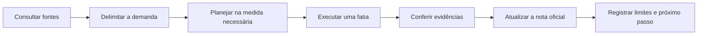

# Fluxo de trabalho com IA

[Voltar à apresentação](../README.md) · [Instruções adaptáveis para agentes](../modelos/Instrucoes-para-Agentes.md)

## O ciclo

## Antes de executar

Localize o projeto, suas instruções e os documentos relevantes. Diferencie fatos atuais, registros históricos e decisões ainda abertas. Carregue somente o contexto necessário para a demanda.

Defina o resultado esperado, o escopo e o que demonstra conclusão. Escolha o plano mais leve que preserve clareza e continuidade. Custo, usabilidade e manutenção entram nessa decisão.

Uma alteração pequena pode precisar de poucas linhas e uma conferência. Um trabalho longo, remoto ou compartilhado exige estado e evidências suficientes para outra pessoa ou agente continuar.

## Durante o trabalho

Execute em partes verificáveis. Use ferramentas e acessos autorizados para a tarefa. A seleção de capacidades deve acompanhar a necessidade; um catálogo de skills não implica ativar todas elas.

Quando houver benefício de especialização, delegue escopos claros e peça artefatos verificáveis. O agente responsável confere o resultado integrado. A coordenação tem custo e precisa melhorar a entrega.

## Ao concluir uma parte

Atualize a fonte documental afetada pelo que mudou: comportamento, contrato, arquitetura, operação, decisão ou estado. Explique a verificação e o que ela sustenta. Uma análise de arquivo, um teste sintético e uma execução real têm alcances diferentes.

Deixe um estado curto com resultado, limites, pendências e próxima ação. A documentação deve permitir retomar o trabalho sem depender de ler uma conversa inteira.

## Retorno esperado

- O que foi alterado e com qual propósito.
- O que foi verificado e qual evidência existe.
- Quais incertezas ou pendências permanecem.
- Qual é o próximo passo e onde está a nota oficial.

## Continuidade e contexto

Use documentos do projeto para fatos e decisões do projeto. Conhecimento transversal só deve ser promovido após curadoria. Histórico de conversa, memória do agente e documentação têm responsabilidades distintas.

Um agente consulta as fontes permitidas e deve citar o documento/seção ao recuperar conhecimento. Se a fonte não sustenta a resposta, registre a lacuna. Novos fatos devem ser conciliados com a nota oficial em vez de acumular resumos contraditórios.
