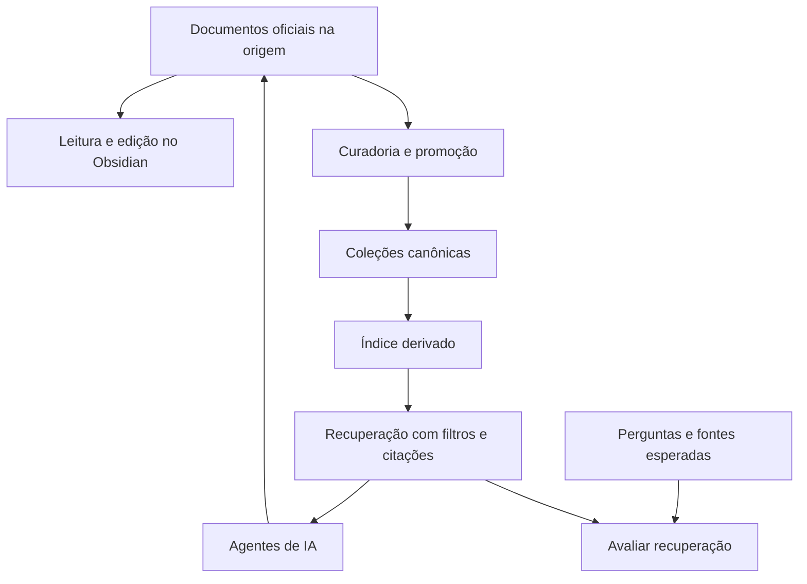

# Neuro-Link e Obsidian

[Voltar à apresentação](../README.md) · [Explorar o Neuro-Link fictício](../exemplo/neurolink/Neuro-Link-Demo.md)

## Responsabilidades

O Obsidian é a interface humana para os arquivos e suas conexões. O Neuro-Link organiza conhecimento curado, sua proveniência e sua recuperação para agentes. A metodologia documental explica o que cada fonte significa e como ela deve ser mantida.

A recuperação pode acessar mais de um namespace, preservando origem e escopo. Uma síntese curada tem finalidade própria e mantém referências às fontes; não deve se tornar uma segunda cópia manual do mesmo guia.

## Estrutura do conhecimento

| Camada | Responsabilidade |
| --- | --- |
| `collections/` | Fontes curadas canônicas. |
| `index/` | Dados derivados e regeneráveis para localizar fontes. |
| `evaluation/` | Perguntas e fontes esperadas para conferir a recuperação. |
| `manifests/` | Origem, versão e identidade dos arquivos usados. |

No exemplo publicado, a fonte foi escrita do zero. O catálogo JSON ilustra metadados; ele não implementa um mecanismo de busca nem o protocolo do ambiente original.

A instalação de referência documenta recuperação lexical com SQLite FTS5. As propostas semânticas/híbridas têm avaliação própria. Este kit não publica o motor de recuperação e não demonstra qualidade de busca por meio de um pequeno exemplo.

## Proveniência e avaliação

Uma resposta recuperada deve identificar URI e seção da fonte. Registre origem, estado documental, escopo e versão/hash quando esses metadados forem usados. As perguntas de avaliação precisam apontar as fontes esperadas.

Antes de mudar a busca, observe a localização da fonte correta, a posição no ranking, a validade das citações e o respeito ao escopo. Um manifesto com hashes demonstra identidade de arquivos; a qualidade de uma resposta exige outra verificação.

## Arquivos locais e acesso remoto

É possível começar com uma pasta local de Markdown. O método não exige reproduzir a infraestrutura remota para organizar e consultar as notas.

A integração específica do ambiente de referência mantém conteúdo por compartilhamento de arquivos e usa SSH para avisar mudanças de metadados ao cliente Obsidian. Os dois fluxos se referem aos mesmos originais. O cliente então solicita a atualização do catálogo; os avisos não contêm uma segunda redação das notas.

Esse monitor/plugin é uma implementação separada, com dependências de versão e ambiente. Seu código e sua instalação não estão incluídos neste kit metodológico. Aqui, os links são arquivos locais comuns.

## Escopo e acesso

A consulta deve manter a origem e respeitar o escopo permitido. Filtros de uma ferramenta são uma camada de governança; isolamento entre usuários e processos depende da infraestrutura que a executa. Conteúdo privado e credenciais ficam fora do corpus e da publicação.
